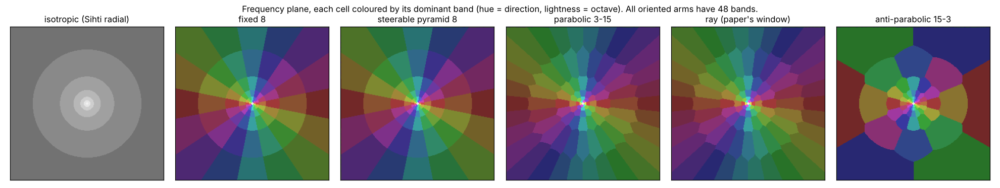
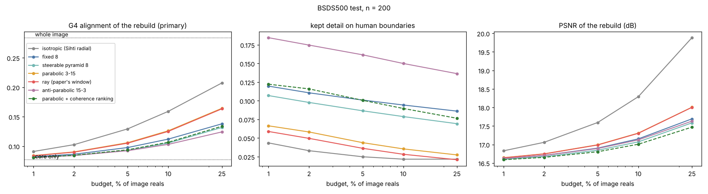
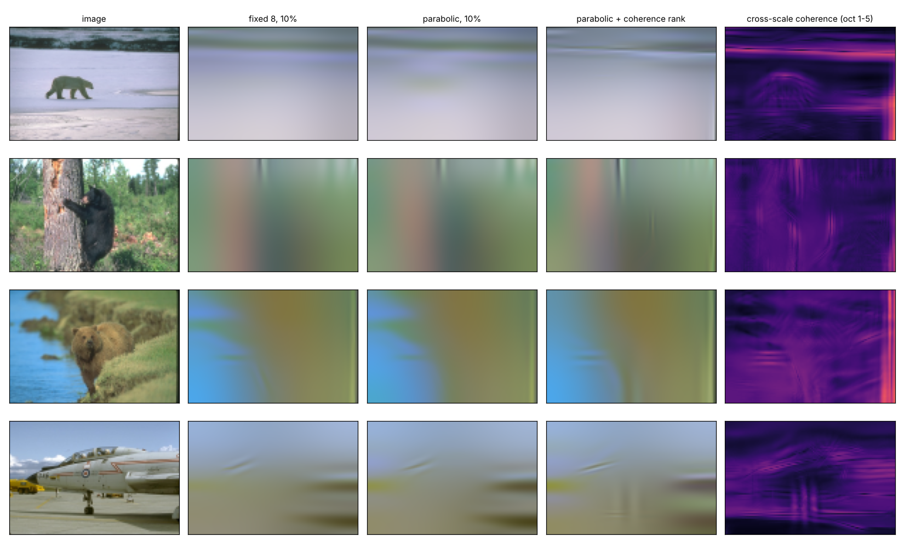

# Parabolic Orientation Sihti

**Does the angular law of a lossless sieve decide where the objects go?**

[Sihti](https://github.com/anttiluode/Sihti) sieves an image into a core plus octave
residues that add back exactly, and its G4 test asks where the *objects* end up. This
repo splits every octave residue further **by direction**, under six direction laws,
keeps only a budget of coefficients, and scores the rebuild with Sihti's own G4 measure
on BSDS500. Live viewer: **[anttiluode.github.io/ParabolicOrientationSihti](https://anttiluode.github.io/ParabolicOrientationSihti/)**
(your image or webcam, all six laws, both rankings, the coherence map).



## Why this test

OpenAI's local-smoothing preprint (Oct 2026, §1.4–2) filters a superposition of waves by
direction by translating spacetime along an imaginary light ray, −iρ(1, ω). That
multiplies mode ξ by **exp(−ρ|ξ|·|ω−ξ̂|²/2)**: a Gaussian in direction whose width
shrinks as (ρ|ξ|)^(−1/2). That is the parabolic scaling law of curvelets
(Candès–Donoho 2004), produced by analytic continuation. The proof also insists the
modes be **summed before squaring**, so their interference survives.

Two questions followed for Sihti. First, does a parabolic direction law put more object
structure into a budget than a fixed one? Second, does a *phase-relationship* score
(cross-scale coherence, the local cross term) pick better coefficients than magnitude?
The paper claims nothing about images. Everything below is our test, not its consequence.

## Result (BSDS500 test, n = 200, pre-registered)

Rules and predictions were pushed in [PREREG.md](PREREG.md) (commit `7bc172e`) before
the test split was touched. Primary: Sihti G4 alignment of the rebuild at a 10 % budget.
Decision rule: higher mean, wins on ≥ 60 % of images, sign test p < 0.01.

| | claim (a beats b) | wins / losses | mean a vs b | p | predicted | outcome |
|---|---|---|---|---|---|---|
| H1 | parabolic > fixed 8 | 145 / 55 | 0.126 vs 0.112 | 1.5e-10 | pass | **PASS** |
| H1k | parabolic > steerable pyramid (**kill condition**) | 171 / 29 | 0.126 vs 0.105 | 1e-25 | pass | **PASS**: not killed |
| H1m | parabolic > fixed 8 **at equal PSNR** | 112 / 88 | 0.116 vs 0.112 | 0.10 | uncertain | fail |
| H1mk | parabolic > steerable pyramid **at equal PSNR** | 134 / 66 | 0.111 vs 0.105 | 1.7e-6 | uncertain | **PASS** |
| H2 | ray (the paper's window) > parabolic steps | 82 / 118 | 0.125 vs 0.126 | 0.013 | fail | fail |
| H3 | coherence ranking > magnitude (G4 alignment) | 45 / 155 | 0.107 vs 0.126 | 2e-15 | fail | fail |
| H3b | coherence ranking puts kept detail on human boundaries | 148 / 52 | 0.090 vs 0.035 | 7e-12 | pass | **PASS** |
| H0 | parabolic > isotropic Sihti | 31 / 169 | 0.126 vs 0.159 | 3e-24 | fail | fail |



## What it means

**1. The direction law matters, and parabolic is the right one.** At equal redundancy
(48 bands each), parabolic beats fixed 8 and the steerable pyramid at every budget from
1 % to 25 %. Anti-parabolic is worst (parabolic beats it 153/47), so it is the
*direction* of the scaling that matters, not merely its unevenness. The kill condition
did not fire.

**2. Most of that is the known curvelet sparsity, and a smaller part may not be.** At
equal reconstruction quality the gain over fixed 8 is not significant (H1m), so against
fixed 8 parabolic mainly compresses better: Candès–Donoho, now measured on objects. Over
the steerable pyramid a gain survives equal PSNR (H1mk). A post-hoc check (not
pre-registered) shows window shape alone does not explain it: fixed 8 vs steerable
pyramid at equal PSNR is 105/95, p = 0.52. So a beyond-sparsity object advantage of the
parabolic law is **suggested, not established**: +0.0044 against fixed 8 at p = 0.10.

**3. The paper's window is a curvelet window.** The continuous imaginary-ray window
(ray) ties the stepwise parabolic one, nominally a hair worse. The physics produces the
right law; it does not produce a better one.

**4. "Relationships before squaring" finds outlines, and outlines are not what G4 calls
objects.** The local cross-scale coherence score moves 2.5× more of the kept energy onto
human boundaries (H3b), and you can see it in the examples: sharper trunk edges and wing
lines. But it lowers G4 alignment (H3). G4 rewards rebuilds that *fill regions* with
their own colour, while coherence spends the budget *drawing their edges*. Both are
object information; they are different kinds, and this is now measured rather than
argued.

**5. No direction law beats having no directions here.** Plain isotropic Sihti wins
(H0). The likely cause is redundancy: iso has 6 bands, the oriented arms 48, all
undecimated, so each oriented coefficient carries less. The equal-PSNR comparison that
was meant to separate this is **not readable**: iso's PSNR at 10 % lies outside
parabolic's whole budget range on 166/200 images. A fair version needs a decimated
(critically sampled) oriented transform.



*First four test images in sorted order (not chosen by result), 10 % budget. 10 % of the
image's reals is ~0.2 % of a 48-band undecimated frame's coefficients, which is why
every rebuild is blurry (~17 dB). The comparison is what survives at that budget.
Rightmost: cross-scale coherence, bright where adjacent octaves agree in phase.*

## Ledger

**Verified**
- Every arm is a tight frame and lossless: core + Σ residues = image to 1e-12, plus the
  frame synthesis (33 Gate 0 tests, `tests/test_gate0.py`)
- The JS viewer reproduces the Python rebuilds to 2e-15
- H1, H1k, H1mk, H3b pass; H1m, H2, H3, H0 fail; all eight came out on the side
  predicted, or split where the prediction was "uncertain"

**Found on the way (Gate 0, before any data)**
- Selecting coefficients in the original quadrant only breaks exactness. The fix: one
  chosen coefficient switches on its three mirror copies, and a flip maps orientation θ
  to π − θ, so the copies live in the partner band.
- The cross term p²/|p|·ā flips sign with edge polarity, so mirrored copies cancel.
  Averaging q²/|q| makes it polarity-invariant.
- Octave-0 coherence is at noise level even on a clean antialiased edge (0.22 vs 0.14),
  so it is excluded from coherence ranking. Octaves 1–5 separate edge from noise
  (0.66–0.83 vs 0.10–0.17).

**Not established / open**
- Whether the parabolic law adds object structure beyond sparsity (H1m p = 0.10)
- Isotropic vs oriented at equal redundancy: needs a decimated transform
- Whether G4 or boundary concentration is the right reading of "object". This repo shows
  they disagree.

**Killed**
- "The paper's window is better than curvelet steps" (H2)
- "Phase-coherence ranking makes the rebuild more object-like" in G4's sense (H3)

**Prior art.** Curvelets and the parabolic law: Candès & Donoho 2004. Steerable pyramid:
Simoncelli & Freeman 1995. Phase-doubled cross-scale statistics p²/|p|: Portilla &
Simoncelli 2000. Phase congruency: Kovesi 1999. Complex-shifted Gaussian beams:
Deschamps 1971. The G4 measure and BSDS protocol: anttiluode/Sihti. The window formula:
OpenAI, *Local smoothing for the Euclidean wave equation*, Oct 25 2026, §1.4–2.

## Run it

```
pip install -r requirements.txt
python -m pytest -q tests                                   # Gate 0
git clone https://github.com/BIDS/BSDS500
python bench.py --bsds BSDS500/BSDS500/data --phase discovery   # val, 30 images, ~7 min
python bench.py --bsds BSDS500/BSDS500/data --phase test        # test, 200 images, ~45 min
python make_figures.py
```

`posihti/frames.py` holds the six frames, `posihti/transform.py` the decomposition,
m-term selection and coherence, `posihti/metrics.py` the Sihti G4 measure (copied
unchanged), `analyze.py` the frozen decision rules. Per-image numbers are in
`results/test_cache.jsonl`.
